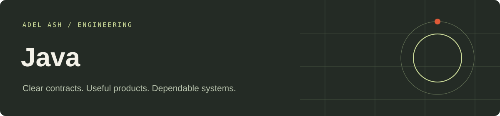

# Java Engineering

Runnable portfolio applications with explicit business rules, browser interfaces and automated checks. Each application has its own folder. All shared source needed by these projects lives inside this repository.

| Application | Folder |
| --- | --- |
| [Ecommerce Order and Fulfillment Service](java/ecommerce-order-and-fulfillment-service-java) | `java/ecommerce-order-and-fulfillment-service-java` |
| [Partner API Gateway](java/partner-api-gateway-java) | `java/partner-api-gateway-java` |
| [Education Assessment and Progress Platform](java/education-assessment-and-progress-platform-java) | `java/education-assessment-and-progress-platform-java` |

## Setup and verification

# Java / Spring Boot application services

Java 21 and Maven 3.9+. From this folder: `mvn test`, then `mvn spring-boot:run "-Dspring-boot.run.arguments=--server.address=127.0.0.1 --server.port=8000 --demo.config=ecommerce-order-and-fulfillment-service-java/project.json"`. Substitute the gateway or education project folder. Each project also contains a `run.ps1` / `run.sh` launcher.

Open `http://127.0.0.1:8000` for the workflow console. The partner gateway requires `Authorization: Bearer local-partner`; other actions use learner/operator/instructor fixture roles. The audit endpoint requires `local-operator`.

Implemented: Java, Spring Boot REST, deterministic validation, synchronized in-memory transactions, outbox fixtures, version conflicts, reviewer permissions, contract versions, a rolling request window and a fixture downstream deadline. JUnit checks duplicate/concurrent requests, rollback-free validation paths, outbox retries, assessment approval and gateway rejections.

Storage is in memory. PostgreSQL/JPA, Redis, Kafka, external identity and Testcontainers are not live integrations in this local implementation. Gateway delay/outage controls are explicit dependency fixtures, not real network outage tests. Restart resets state.

## Repository guide

- Application READMEs include launch commands, sample inputs and workflow details.
- Architecture documents describe storage and failure boundaries.
- GitHub Actions runs stack-specific checks on changes.
- Local roles and sample records are development examples. Keep them on localhost; configure trusted identity, secrets and operational controls for any public deployment.

## Portfolio

[View this stack’s work](https://adelash.vercel.app/java) · [Email Adel Ash](mailto:tech.dev.workspace@gmail.com)
