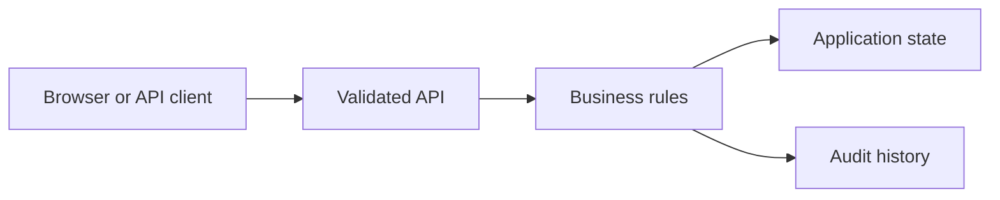

# Partner API Gateway application

Created a Spring Boot partner gateway application with explicit local role checks, versioned contracts and runtime validation. Added a rolling request limit, trace IDs and distinct fixture deadline and dependency errors. Verified permission, contract, timeout and rate-limit behavior with JUnit.

## Run locally

Start from the `java/` directory of this repository.

```sh
mvn spring-boot:run -Dspring-boot.run.arguments="--demo.config=partner-api-gateway-java/project.json"
```

The browser console is available at `http://127.0.0.1:8000` for API applications. For frontend applications, use the frontend development server described in the setup below.

## Architecture



## Workflow

Available actions: `request`.

Open `project.json` for the available commands and example inputs when present. Use the operator role to inspect state and audit history. Retry an accepted command with the same identifier to observe replay behavior; change its payload or expected version to exercise conflict handling.

## Verification

Run the automated checks from the stack directory:

```sh
mvn test
```

The checks exercise business rules, permission boundaries and failure recovery. Sample records are synthetic. Development credentials are local examples; use managed identity, external secrets and your own deployment controls before exposing services publicly.

## Implementation notes

# Partner API Gateway application

Require an explicit partner role, validate the supported contract version, apply a rolling request limit and return distinct fixture deadline and dependency errors.

## Purpose

Require an explicit partner role, validate the supported contract version, apply a rolling request limit and return distinct fixture deadline and dependency errors.

## Run

See the family-level README one directory above for the installed runtime and command. Use this folder's `project.json` to select this application.

## Workflow

Domain: **gateway**. Available commands: request.

The configuration includes request examples. Inspect state and the audit log after a successful command, then retry it or change its version to observe duplicate and concurrency behavior.

## Configuration

Core workflow demo only. Local fixture authentication and local development storage. External cloud services, live AI model calls and production database/broker integrations from the broader CV descriptions are not configured here. Read the family-level README for the actual implemented stack and tests.

## Architecture

[Architecture and failure boundaries](ARCHITECTURE.md). Shared workflow modules and tests are in the parent stack folder.

